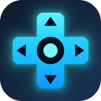

   
  <strong>Navigasi ala remote TV untuk Chrome: D-Pad, pengalih tab, dan kontrol video di semua situs.</strong>

  

---

## 🇮🇩 Bahasa Indonesia

### Untuk Siapa?
RemoteTV D-Pad dirancang untuk Anda yang sering menonton YouTube, Netflix, atau situs streaming/web lainnya dari PC atau laptop yang tersambung ke layar TV, menggunakan **mini keyboard**, **air mouse**, atau **keyboard biasa** dari jarak jauh tanpa perlu repot menggerakkan kursor mouse.

### Fitur Utama
- **Navigasi D-Pad Spasial**: Satu card thumbnail = satu perhentian terdekat (navigasi kiri/kanan selalu berada dalam baris yang sama).
- **Dua Mode Operasi**: Mode Navigasi Halaman (default) dan Mode Kontrol Video (berpindah instan via tombol `Tab` atau `P`).
- **OSD ala TV**: Tampilan status di layar (*On-Screen Display*) saat volume, posisi seek, dan status video berubah.
- **Efek Suara Navigasi**: Suara klik halus saat berpindah antar elemen web.
- **Auto-Skip Iklan & Intro**: Otomatis lewati iklan YouTube, otomatis skip intro/recap di Netflix, serta fokus otomatis ke tombol *Next Episode*.
- **Ingat Posisi Fokus Terakhir**: Fokus elemen web sebelumnya dipulihkan secara otomatis saat menekan tombol *Back*.
- **Kontrol Player Tetap Tampil**: Control bar pemutar video tetap muncul otomatis selama fokus berada pada tombol kontrol video.
- **Pengalih Tab Bawaan**: Buka daftar tab dan berpindah antar tab langsung dari keyboard.
- **Popup Pengaturan Lengkap**:
  - Sakelar ON/OFF global dan daftar nonaktif per situs (*disabled sites*).
  - Toggle masing-masing fitur secara independen.
  - Pilihan durasi lompatan seek: 5, 10, 15, atau 30 detik.
  - Pilihan langkah volume: 5%, 10%, atau 20%.
  - 6 pilihan warna ring fokus (*Cyan, Green, Yellow, Pink, Purple, White*).
  - Pilihan bahasa antarmuka: Otomatis, Indonesia, atau English.
  - Pengaturan tersinkronisasi otomatis ke akun browser Anda via `chrome.storage.sync`.

### Tabel Pintasan Tombol

| Tombol | Fungsi |
| --- | --- |
| **Panah (↑ / ↓ / ← / →)** | Berpindah fokus antar elemen / thumbnail / tombol |
| **Enter** | OK / Klik elemen yang sedang disorot fokus |
| **Backspace** | Kembali ke halaman sebelumnya / Keluar dari layar penuh |
| **Tab** atau **P** | Ganti mode antara Navigasi Halaman dan Kontrol Video |
| *(Mode Kontrol Video)* **← / →** | Lompat mundur / maju (*Seek*) sesuai durasi detik yang diatur |
| *(Mode Kontrol Video)* **↑ / ↓** | Naikkan / Turunkan volume suara |
| *(Mode Kontrol Video)* **Enter / Spasi** | Putar / Jeda video (*Play / Pause*) |
| **F** | Masuk / Keluar layar penuh (*Fullscreen*) |
| **M** | Bisukan / Bunyikan audio (*Mute / Unmute*) |
| **C** | Aktifkan / Nonaktifkan subtitle atau takarir (*CC*) |
| **S** atau **/** | Fokus langsung ke kolom pencarian situs |
| **T** | Buka daftar tab (↑/↓ pilih tab, Enter pindah, Delete/X tutup tab, Esc batal) |
| **[** dan **]** | Berpindah langsung ke tab sebelumnya / berikutnya |
| **Esc** | Keluar dari kolom ketik / Tutup modal dialog |

### Cara Instalasi (Manual / Developer Mode)
1. Unduh repositori ini sebagai file ZIP (lalu ekstrak) atau *clone* ke komputer Anda.
2. Buka peramban Google Chrome dan masuk ke alamat `chrome://extensions`.
3. Aktifkan **Developer mode** di sudut kanan atas.
4. Klik tombol **Load unpacked** di sudut kiri atas.
5. Pilih folder ekstensi `RemoteTV`.
6. Ekstensi siap digunakan!
> **Update**: Jika Anda memperbarui berkas ekstensi, cukup kembali ke halaman `chrome://extensions` dan klik ikon reload pada kartu RemoteTV D-Pad.

### Izin & Privasi
- `<all_urls>` (Content script): Digunakan agar navigasi D-Pad dan kontrol media dapat berjalan di semua situs web yang Anda kunjungi.
- `tabs`: Digunakan untuk membaca judul dan URL tab agar fitur pengalih tab (Tab Switcher) dapat menampilkan daftar tab yang terbuka.
- `storage`: Digunakan untuk menyimpan preferensi dan konfigurasi pengaturan Anda via sinkronisasi Chrome.
- `activeTab`: Digunakan untuk mendeteksi informasi tab aktif saat membuka popup pengaturan.

Ekstensi ini **tidak memiliki server eksternal, tidak menggunakan analitik, dan tidak mengumpulkan atau mengirim data apa pun ke pihak luar**. Seluruh kode berjalan 100% secara lokal di browser Anda.

### Keterbatasan yang Diketahui
- **Intersepsi Tombol**: Tombol panah dan tombol pintasan satu huruf diambil alih di situs web aktif. Hal ini dapat berbenturan dengan web games, aplikasi peta (seperti Google Maps), atau editor dokumen online. Anda dapat menonaktifkan ekstensi secara spesifik pada situs tersebut melalui menu popup.
- **Perubahan Struktur Situs**: Skrip auto-skip dan selektor tombol YouTube/Netflix dapat terpengaruh jika pihak penyedia layanan mengubah struktur DOM situs mereka sewaktu-waktu.
- **Halaman Internal Chrome**: Sesuai kebijakan keamanan browser, ekstensi tidak dapat bekerja di halaman sistem `chrome://`, Chrome Web Store, atau halaman Tab Baru (*New Tab*).
- **Deteksi Perangkat**: Web browser tidak dapat membedakan input dari keyboard internal laptop dengan keyboard nirkabel eksternal.

### Struktur Berkas
- `manifest.json`: Manifest konfigurasi ekstensi Chrome (Manifest V3).
- `remote.js`: Content script utama yang menangani navigasi D-Pad spasial, pemutar video, dan OSD.
- `background.js`: Service worker latar belakang untuk manajemen tab dan pesan ekstensi.
- `popup.html`: Struktur antarmuka pop-up menu pengaturan.
- `popup.css`: Lembar gaya (styling) antarmuka pop-up dengan tema gelap Android TV.
- `popup.js`: Logika interaktif pop-up dan manajemen pengaturan.
- `i18n.js`: Modul kamus internasionalisasi bahasa (Bahasa Indonesia & English).
- `icons/`: Direktori aset ikon ekstensi (16px, 32px, 48px, 128px).

### Kontribusi
Kontribusi dalam bentuk *Issue* dan *Pull Request* sangat diterima! Jika Anda menemukan situs web streaming yang mengalami kendala navigasi, silakan buka Issue baru dengan menyertakan URL situs dan penjelasan kendalanya.

### Lisensi
Proyek ini didistribusikan di bawah lisensi [MIT](LICENSE).

---

## 🇬🇧 English

### Overview
RemoteTV D-Pad turns your PC or laptop connected to a TV into a lean-back media center, allowing seamless navigation on YouTube, Netflix, and any website using a mini keyboard, air mouse, or regular keyboard without touching a mouse.

### Key Features
- **Spatial D-Pad Navigation**: One card = one stop, horizontal movement stays strictly on the same row.
- **Dual Operating Modes**: Page Navigation Mode (default) and Video Control Mode (toggle instantly via `Tab` or `P`).
- **TV-Style OSD**: Visual on-screen feedback for volume adjustments and seeking.
- **Navigation Sound Effects**: Subtle audio clicks on focus shifts.
- **Auto-Skip**: Automatically skips YouTube ads, Netflix intros/recaps, and focuses the Next Episode button.
- **Focus Memory**: Automatically restores your previous focus position when navigating back.
- **Player Control Bar Retention**: Player controls stay visible while focused on control buttons.
- **Tab Switcher**: View open tabs and switch between them effortlessly.
- **Customizable Popup**: Global & per-site toggles, customizable seek/volume steps, 6 focus ring colors, and multilingual support (Auto/ID/EN).

### Shortcut Table

| Key | Action |
| --- | --- |
| **Arrow Keys** | Move focus to adjacent elements |
| **Enter** | OK / Click focused element |
| **Backspace** | Go back / Exit fullscreen |
| **Tab** or **P** | Toggle between Navigation & Video Control Mode |
| *(Video Mode)* **← / →** | Seek backward / forward |
| *(Video Mode)* **↑ / ↓** | Volume up / down |
| *(Video Mode)* **Enter / Space** | Play / Pause |
| **F** | Toggle Fullscreen |
| **M** | Mute / Unmute audio |
| **C** | Toggle Subtitles / Captions (CC) |
| **S** or **/** | Focus Search Box |
| **T** | Tab Switcher list (↑/↓ choose, Enter switch, Del/X close, Esc exit) |
| **[** and **]** | Previous / Next tab |
| **Esc** | Exit input fields / close modals |

### Manual Installation
1. Clone or download this repository as a ZIP archive and extract it.
2. Open Google Chrome and navigate to `chrome://extensions`.
3. Enable **Developer mode** at the top right corner.
4. Click **Load unpacked** at the top left corner and select the `RemoteTV` directory.
5. To update, replace the files and click the reload icon on the extension card.

### Privacy & Permissions
Requires `<all_urls>` (for content script navigation on web pages), `tabs` (to query tab titles and URLs for the Tab Switcher), `storage` (for synced settings), and `activeTab`. This extension operates entirely offline without telemetry, analytics, or external server calls.

### Known Limitations
- Overrides arrow and shortcut keys on active pages; can conflict with web games, maps, or rich document editors (can be disabled per site via the popup).
- Video site selectors (YouTube/Netflix) may change over time.
- Cannot run on `chrome://` pages, the Chrome Web Store, or the New Tab page.
- Cannot distinguish between built-in and external keyboards.

### License
Released under the [MIT License](LICENSE).
